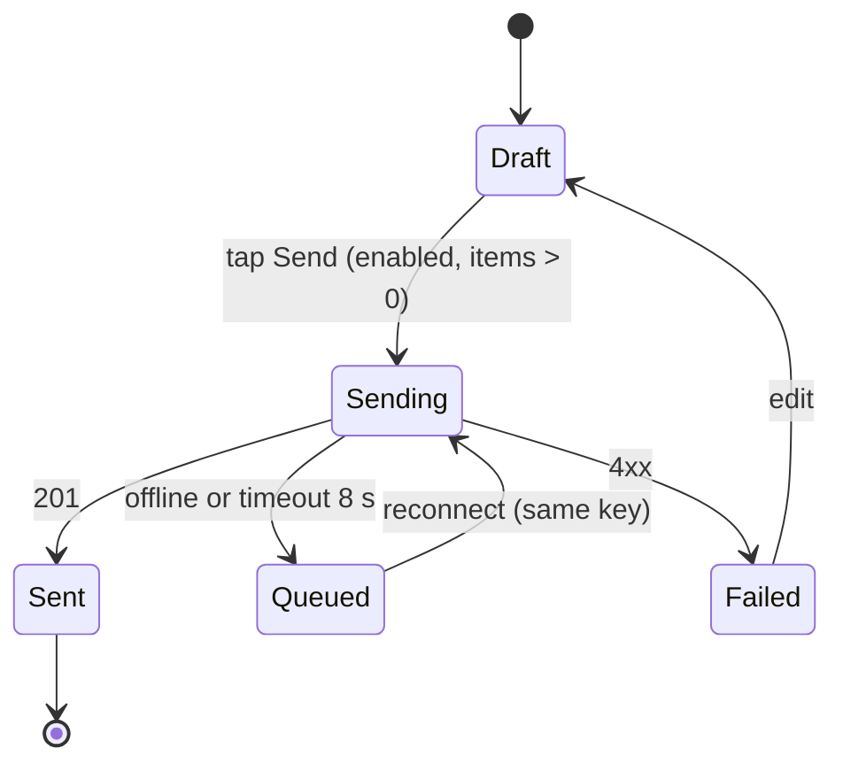

# Interaction Designer: Examples

Business names below are fictional unless stated.

## Example 1: "Send to kitchen" in a waiter app with weak Wi-Fi
**Request:** "Waiters at Spice Route (fictional) add items on a phone and tap 'Send to kitchen'. Wi-Fi drops near the back tables. Orders must never be duplicated."

**Key decisions:**
- Pessimistic: kitchen tickets have real cost, so no optimistic "sent".
- Each order draft gets an idempotency key on creation; retries reuse it.
- Offline: the button changes to "Queued, will send", the order is stored locally, and a persistent banner shows "1 order waiting for network". Auto-send on reconnect, then confirmation.
- Double tap: button disables on first tap within 100 ms.

**Output (excerpt):**

| Action | Optimistic? | Offline | Retry | Idempotent | Conflict rule | Feedback |
|---|---|---|---|---|---|---|
| Send to kitchen | No | Queue locally | Auto on reconnect, then manual | Yes, key per draft | Server rejects duplicate key | Button state + persistent banner + "Sent at 8:42 pm" line |

## Example 2: Parent photo upload for a school event album
**Request:** "Teachers upload up to 40 event photos at once from their phones."

**Key decisions:**
- Over 10 s expected: per-file determinate progress plus an overall count ("12 of 40"), user can leave the screen; uploads continue while the app is open.
- Failed files show individually with retry; the batch is not lost.
- Reduced motion: progress bars update without the shimmer.
- Text slots for `ux-writer`: failure line (max 60 chars), completion toast (max 40 chars) plus a persistent album link.

**Output (excerpt):**
| Element | Trigger | From | To | Properties | Duration | Easing | Reduced motion |
|---|---|---|---|---|---|---|---|
| File row | upload starts | queued | uploading | opacity 0.6 to 1 | 150 ms | ease-out | instant |
| Progress bar | progress event | n% | m% | transform scaleX | 200 ms | linear | step change |
| File row | 4xx/5xx | uploading | failed | icon swap, opacity | 150 ms | ease-out | instant |

## Example 3: Boundary: "Add undo to the WhatsApp fee reminder broadcast"
**Request:** "After the admin taps 'Send reminders', give them an undo button like Gmail."

**Response (excerpt):** "Once WhatsApp messages are sent, they can't be recalled from parents' phones, so a true undo is impossible. Two safe options: (1) a 10-second 'Sending in 10 s, Cancel' state before anything is sent, or (2) a confirmation dialog naming the count and the message ('Send fee reminder to 126 parents?'). I recommend option 1 plus a preview. Message templates and opt-in rules go to `whatsapp-business-specialist`, and any automatic sending needs the owner's approval."
