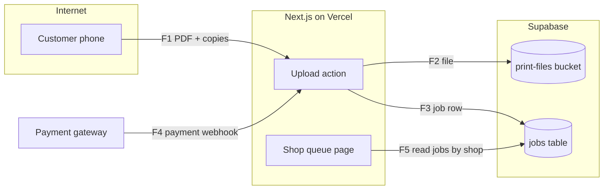

# Threat Modeling Specialist: Examples

Business names below are fictional unless stated.

## Example 1: QR print-shop upload app (full model)
**Request:** "Threat model the print-shop app: customers scan a QR at the counter, upload PDFs, choose copies and pay by UPI; the shop owner sees a queue and prints."

**Key decisions:**
- Full depth: document uploads plus payments.
- Boundaries: customer phone to app, app to storage, app to payment gateway, shop to shop (the product is sold to many shops, so tenant isolation is a boundary).
- Abuse focus: fake UPI screenshots, uploads of malicious or illegal files, one shop seeing another shop's queue, documents (Aadhaar copies, marksheets) left in storage forever.

**Output (excerpt):**


| ID | Element / flow | STRIDE | Threat | Tier | L | I | Score | Mitigation | Control | Owner | Story / AC |
|---|---|---|---|---|---|---|---|---|---|---|---|
| T1 | F5 | I | Owner of Shop A lists Shop B's jobs and files by changing shop id | 2 | 3 | 4 | 12 | RLS on jobs and storage by `shop_id` from membership table | Preventive | database-engineer | Owner of shop A querying shop B returns 0 rows |
| T2 | F4 | S, T | Customer shows a fake UPI screenshot; staff prints and hands over | 1 | 4 | 2 | 8 | Job marked paid only by verified gateway webhook; queue shows paid status, not screenshots | Preventive | integration-engineer | Job without webhook stays "unpaid" |
| T3 | S | I | ID-proof PDFs kept indefinitely and readable by URL | 1 | 3 | 4 | 12 | Private bucket, signed URLs (10 min), auto-delete 24 h after printing | Preventive + detective (deletion job alert) | backend-developer | File URL fails after expiry; deletion job logs count daily |

## Example 2: Incremental update for a school portal
**Request:** "We're adding WhatsApp fee reminders to the school portal. Update the threat model from v2."

**Key decisions:**
- Incremental mode: only new flows (portal to WhatsApp provider, webhook for delivery status).
- New D (cost) threat: a bug or abuse that loops reminders burns template message charges.
- New I threat: reminder text containing fee amount and child name goes to a wrong or old number.

**Output (excerpt):**
```
Threat model diff: school-portal v2 -> v3 (design doc 2026-10-18)
New: T14 (D) reminder loop sends repeated paid templates -> per-parent daily cap of 1, provider spend alert. Owner: integration-engineer.
New: T15 (I) child name and dues sent to outdated number -> confirm number at each term start; message excludes amount, links to login. Owner: product-owner (story), whatsapp-business-specialist (template).
Changed: none. Resolved: T9 (signed URL expiry) verified by application-security-engineer on 2026-10-10.
Flag to privacy-specialist: new processor (WhatsApp provider) receives parent phone numbers.
```

## Example 3: Boundary: "just make it secure, skip the model"
**Request:** "We don't have time for a threat model on the clinic booking app. Just tell the developer to make it secure."

**Response (excerpt):** "'Make it secure' gives the developer nothing to build or test. A rapid model takes about 2 hours: one diagram and the top threats for login, booking and the doctor's notes. Clinic data includes health information, so the full depth table normally applies; I'm proposing the rapid version as a compromise and listing what it skips. If even that is declined, I need the owner to accept in writing that the build goes ahead without a model, and I'll record it as an accepted risk."
